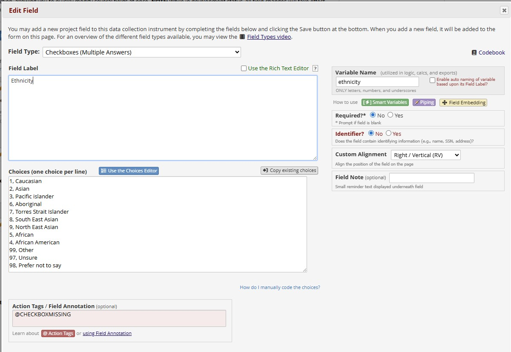
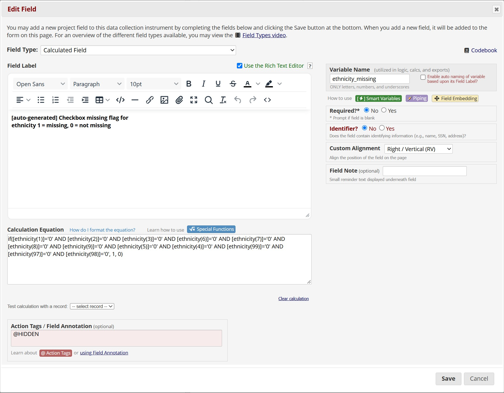
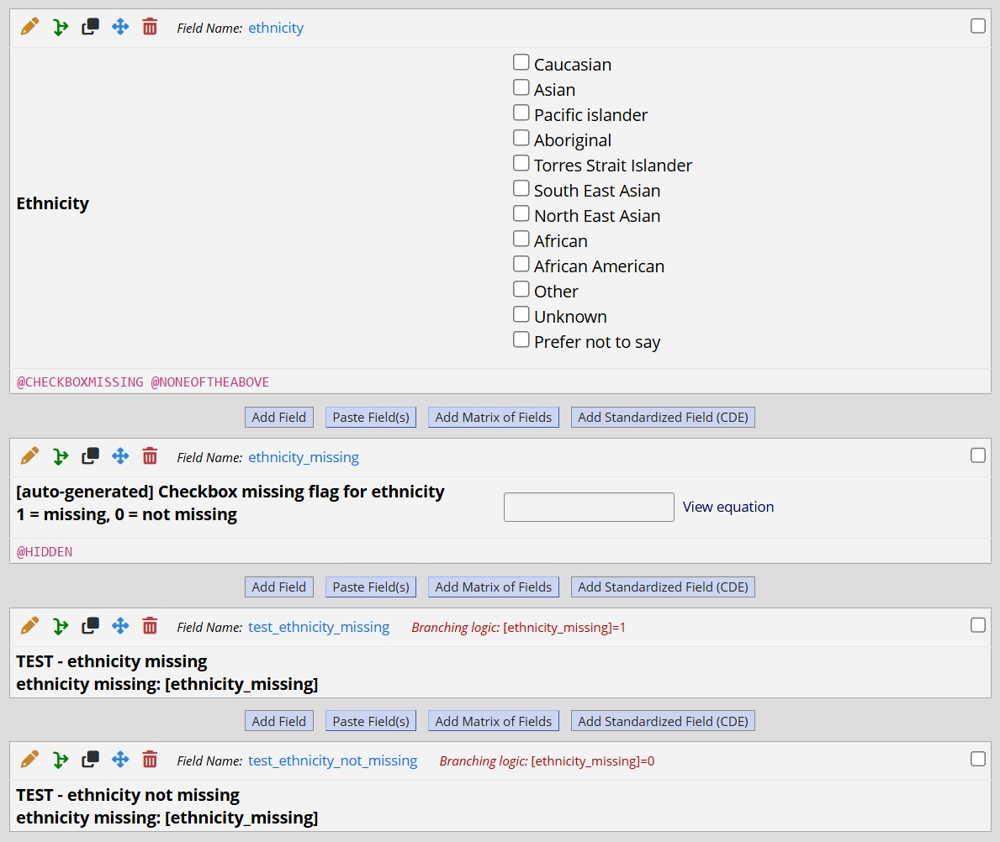
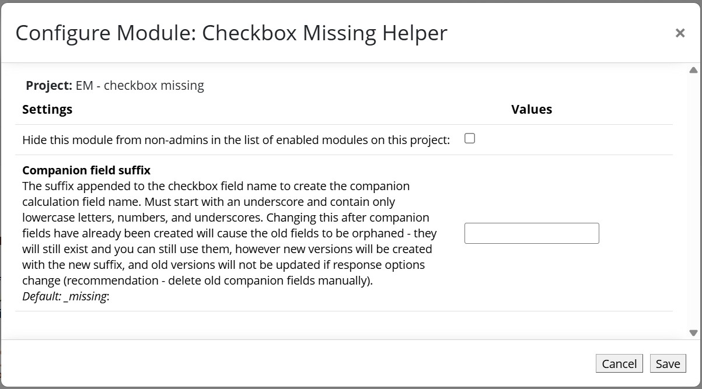

# Checkbox Missing Helper

A REDCap module that allows the addition of a `@CHECKBOXMISSING` action tag for checkbox fields. Because each option in a checkbox field is stored as a separate binary (0/1, unchecked/checked) sub-field, assessing whether the entire field is unanswered normally requires verbose logic like `[ethnicity(1)]='0' AND [ethnicity(2)]='0' AND [ethnicity(3)]='0'`. This module eliminates that by automatically creating and maintaining a companion calculation field that equals `1` when all options are unchecked (MISSING), and `0` when at least one option is checked (NOT MISSING).

## Prerequisites
- REDCap >= 14.6.4 (LTS >= 15.0.9), the first versions supporting Module Framework version 16
- REDCap Module Framework version 16

## Easy Installation
- Install the Checkbox Missing Helper module from the Consortium [REDCap Repo](https://redcap.vanderbilt.edu/consortium/modules/index.php) from the control center.
- Go to **Control Center > External Modules**, enable Checkbox Missing Helper.

## Manual Installation
- Clone this repo into `<redcap-root>/modules/checkbox_missing_v1.0.0`.
- Go to **Control Center > External Modules**, enable Checkbox Missing Helper.

## Usage

### 1. Add the action tag to a checkbox field

In the Online Designer, open any checkbox field and add `@CHECKBOXMISSING` to the **Action Tags / Field Annotation** box. Save the field.

The module will automatically create a companion calculation field named `fieldname_missing` (or `fieldname_` + your configured suffix) immediately after the checkbox field in the instrument. For example, a checkbox field named `ethnicity` will produce a companion field named `ethnicity_missing`. An @HIDDEN action tag will be added to the companion calculation field.

### 2. Use the companion field in logic

Reference the companion field anywhere REDCap accepts field logic, the same way as a standard calculation is referenced (`[ethnicity_missing]=1`)

A value of 1 means the checkbox field is completely unanswered. A value of 0 means at least one option is checked.

Because the companion field is a native REDCap calculation field, it updates in real time as users interact with the form - no custom JavaScript is required on data entry forms or surveys.

## Configuration

The module can be configured at the project level via **External Modules > Checkbox Missing Helper > Configure**.

| Setting | Default | Min – max and limitations |
|---|---|---|
| **Companion field suffix** | `_missing` | Appended to the checkbox field name to form the companion calculation field name. Must start with an underscore and contain only lowercase letters, numbers, and underscores; anything else falls back to `_missing`. |

For example, setting the suffix to `_blank` would produce `ethnicity_blank` instead of `ethnicity_missing`.

> **Warning:** Changing the suffix after companion fields have already been created will orphan the old fields - they will no longer be updated by the module. You will need to delete the old companion fields manually and allow the module to recreate them with the new suffix.

## Behaviour

- The companion field is created automatically after the action tag is added: when the field is saved in the Online Designer, or straight after a Data Dictionary upload. The page will reload once to display the new field, and a green banner confirms it.
- If checkbox options are **added or removed**, the companion field's formula is updated automatically after the original field is saved in the Online Designer - no page refresh required. A blue banner lists the updated fields.
- If the checkbox field is **renamed**, the companion field is renamed to match (e.g. `ethnicity_missing` becomes `ethnicity_v2_missing`) rather than a second companion being created. References to the old companion name in the data dictionary (branching logic, calculations, action tags such as `@CALCTEXT` and `@IF`, and piping in labels, notes and section headers) are updated to the new name, and the banner lists the fields changed. Alerts, Data Quality rules, reports and survey settings are not updated; check them for the old name. REDCap's own "fields referencing the old variable name" notice will list the companion field; it's handled automatically, and the page reloads once you close the notice.
- The companion field label is `[auto-generated] Checkbox missing flag for fieldname   1 = missing, 0 = not missing`. 
- The companion field is hidden from data entry forms and surveys (`@HIDDEN`) and should not be edited manually.

## Notes

- The companion field must remain on the same instrument as its source checkbox field.
- If the companion field is deleted, it will be re-created automatically the next time an instrument is opened in the Online Designer.
- The module runs while an instrument is open in the Online Designer, and straight after a successful Data Dictionary upload; each time it checks every instrument in the project. After a Data Dictionary upload the changes are made without a banner; banners only appear inside an instrument in the Online Designer.
- Renaming only changes the data dictionary, as REDCap does for the checkbox itself: data/values already saved under the old names aren't automatically associated with the newly named variable. In a project with data, save the records or run Data Quality rule H to recalculate the renamed companion field.
- A rename is recognised when the companion field is directly below the checkbox, or is the only unmatched companion on that instrument. If several checkboxes on one instrument are renamed and their companions have been moved, new companion fields are created and the old ones are left for you to delete.
- The action tag has no effect on non-checkbox field types.
- In practical application, generally a "None of the above" response option is recommended for the multi-checkbox variable to be considered truly missing; otherwise, all responses unchecked could actually mean none of the responses were legitimately selected/applicable.

## AI assistance
Development of this project has made extensive use of AI assistance. AI tools, primarily Claude Pro, have been used throughout the development process, including for discussion and refinement of design and architecture, implementation and refactoring of code, debugging and review, and preparation and revision of documentation.

The extent and nature of this assistance vary across the project and are not attributed to individual commits. AI-generated suggestions and contributions are reviewed, adapted, and integrated as part of the normal development process.

Responsibility for the design, implementation, maintenance, and released software remains entirely with the project maintainer.

## Acknowledgments

Developed by Kerrin Palazzi, Hunter Medical Research Institute.
